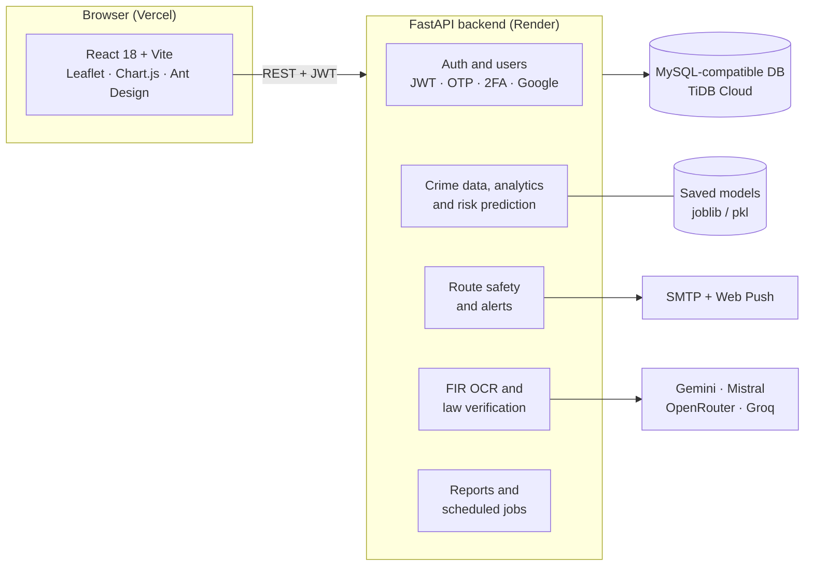
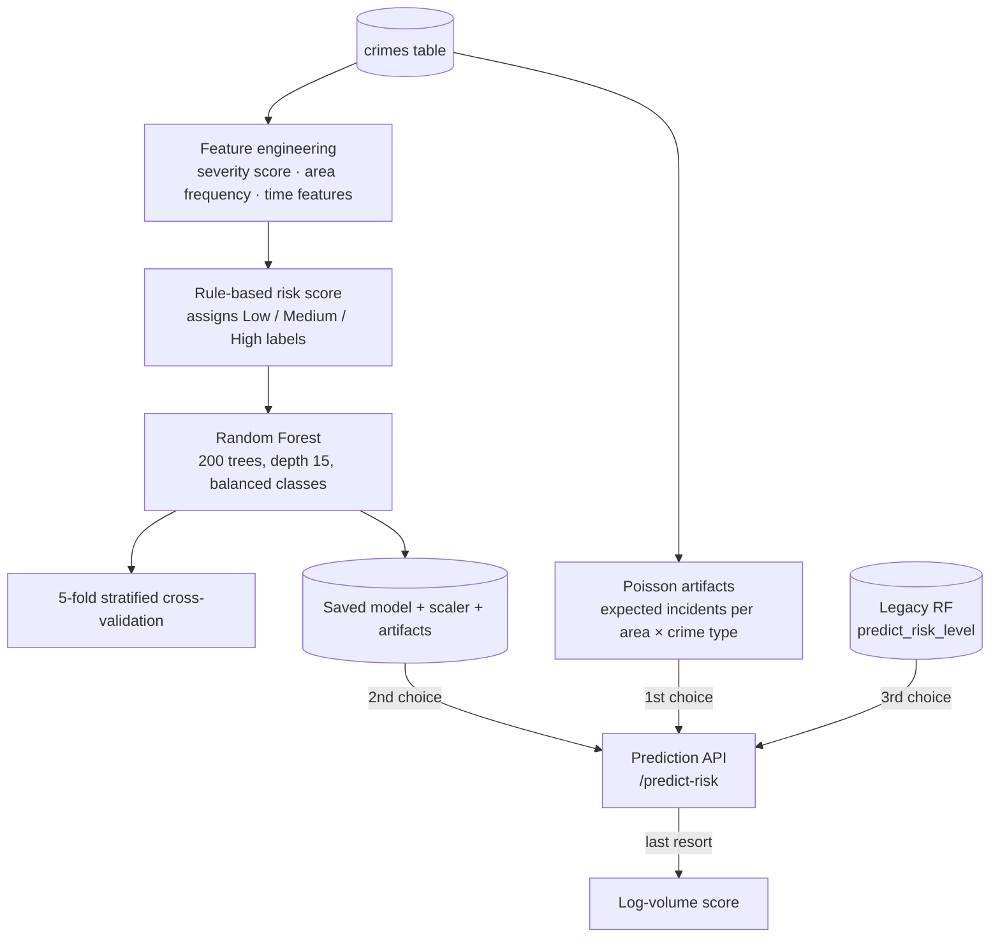
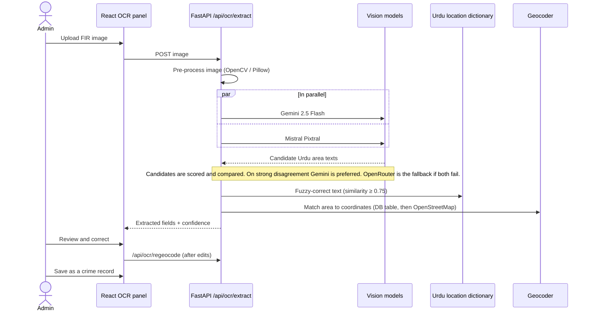

# SafeVision: Spatial Visualytics of Reported Incidents in Lahore

> A crime-analytics and risk-prediction platform for Lahore. Reported incidents are mapped, scored and turned into area risk levels, safer-route suggestions and alerts. Admins can digitise Urdu FIR documents with an AI-assisted OCR workflow.

**Live demo:** https://safevision.vercel.app/ &nbsp;·&nbsp; Final-year project, BS Computer Science, NUML Lahore


---

## Contents
[What it does](#what-it-does) · [Architecture](#architecture) · [Machine learning](#machine-learning-and-what-the-numbers-mean) · [FIR OCR pipeline](#fir-ocr-pipeline) · [Roles](#roles) · [Tech stack](#tech-stack) · [Run it locally](#run-it-locally) · [Deployment](#deployment) · [Project structure](#project-structure) · [Limitations](#known-limitations)

## What it does

| Area | Features |
|---|---|
| **Crime map** | Interactive Leaflet map with incident markers, heat-map layer, area search and per-area safety profiles and advice |
| **Risk prediction** | Scores an area and crime type as Low / Medium / High, using a Poisson expected-incident estimate first and Random Forest models as fallbacks |
| **Safe routes** | Calculates several routes between two points and scores each one from nearby incidents and infrastructure (police stations, hospitals, road type, lighting, time of day) |
| **Alerts** | Area-based alerts by e-mail and browser push notifications (Web Push / VAPID), with user location preferences and cooldowns |
| **FIR digitisation** | Admins upload an FIR image. Vision models (Gemini and Mistral, with an OpenRouter fallback) read the date, area and PPC sections, and the admin reviews the result before saving |
| **Law sections** | A Pakistan Penal Code (PPC) section library with AI verification and an approval and audit workflow |
| **Community & emergency** | Community statistics and alerts, emergency contacts, emergency calls and patrol requests |
| **Reporting** | PDF, Excel and CSV crime summaries, scheduled admin reports and downloadable history |
| **Security** | JWT access and refresh tokens, bcrypt password hashing, e-mail verification, e-mail OTP login, TOTP two-factor authentication, Google sign-in, rate limiting, audit logs |

## Architecture



### Risk-model training flow



## Machine learning, and what the numbers mean

`POST /predict-risk` tries these in order and uses the first one that works:

1. **Poisson estimator** (primary). From historical counts it estimates the expected incidents per day for an area and crime type (λ) and the chance of at least one incident, P(≥1) = 1 − e^(−λ). The risk score is 0.60 × Poisson score + 0.40 × log-scaled volume. Saved artifacts cover 1,177 area × crime-type pairs (64 areas, 41 crime types) over a 365-day window.
2. **`crime_risk_model`**, a Random Forest classifier.
3. **`predict_risk_level`**, a second, smaller Random Forest.
4. **Log-volume score** if no model file can be loaded.

The two Random Forests are scikit-learn models. Their saved results are listed below because they are easy to misread.

| Model | Data it was trained on | Evaluation | Saved result |
|---|---|---|---|
| `crime_risk_model` (Random Forest, 200 trees) | 25,396 records (trained 2026-05-12), 64 areas, 41 crime types | 5-fold stratified cross-validation | CV accuracy **99.2% ± 0.15%** |
| `predict_risk_level` (Random Forest, 50 trees) | 25,377 records, 62 areas, 40 crime types, dated 2025-01-01 to 2026-05-05 | 70/30 train/test split (7,614 test rows) | Test accuracy **57.3%**, macro F1 0.58 (Medium recall is lowest at 0.38) |

**How to read these honestly**
- In `crime_risk_model`, the risk labels are produced by a **rule-based scoring function** (severity, area frequency and time), and the forest learns to reproduce them. The 99% therefore measures how well the model copies that rule. It is **not** a measure of forecasting real crime.
- `predict_risk_level` has to predict a three-class label from only area, crime type and date. 57% on held-out rows is the more realistic number for that setup.
- Neither model has been validated against future, unseen incidents. Treat the output as a **relative risk indicator for exploration**, not a prediction of where crime will occur.

The training database is not committed. The repository ships seed CSVs (`crime_risk_model/data/`) with 50,165 demo rows from 2024-01-01 to 2025-07-04, covering 28 areas and 5 crime types. Of these, 33,437 are marked `public` and 16,728 `predicted`.

## FIR OCR pipeline



- Gemini and Mistral are queried **in parallel**, each answer is scored, and the best candidate wins (Gemini is preferred if they strongly disagree). OpenRouter is a separate-quota **fallback**, so one rate-limited free tier does not stop the workflow.
- The correction step uses a dictionary of **486 distinct Lahore locations** (areas, markets, roads, landmarks), character-level fixes for common misreads, and fuzzy matching.
- The code also contains an optional local engine path (EasyOCR / PaddleOCR / Tesseract). Those libraries are **not** in `requirements.txt` and are not used in the deployed configuration.
- A human always reviews the extracted values before they are saved.

## Roles

| Role | Can do |
|---|---|
| **User** | View the map and heat map, check area safety, predict risk, plan safe routes, manage alerts and location preferences, use emergency features |
| **Admin** | Everything above, plus FIR OCR review, crime data management, analytics, approval requests, reports and user management |
| **Super Admin** | Everything above, plus admin management, a permission matrix, PPC law-section management, system settings and audit and system logs |

## Tech stack

| Layer | Technology |
|---|---|
| Frontend | React 18, Vite 4, React Router 7, Leaflet (+ heat, routing machine), Chart.js, Ant Design, React-Bootstrap, jsPDF |
| Backend | Python 3.11, FastAPI, Uvicorn, Pydantic, APScheduler, mysql-connector |
| ML and data | scikit-learn, pandas, NumPy, joblib, Poisson rate models |
| OCR / AI | Gemini 2.5 Flash, Mistral Pixtral, OpenRouter, Groq (law-section verification), OpenCV, Pillow |
| Auth | JWT (python-jose), bcrypt, pyotp (TOTP), Google OAuth |
| Reports | ReportLab, openpyxl, matplotlib |
| Database | MySQL-compatible: local MySQL for development, TiDB Cloud Serverless in production |
| Hosting | Vercel (frontend), Render (backend, `render.yaml`) |

## Run it locally

**Prerequisites:** Python 3.11, Node.js 18+, a MySQL-compatible database.

### 1. Backend
```bash
cd CrimeVision/backend
python -m venv venv
source venv/bin/activate          # Windows: venv\Scripts\activate
pip install -r requirements.txt

cp .env.example .env              # then fill in your own values
uvicorn main:app --reload --port 8000
```
The `.env.example` file lists every setting. At minimum, set the database variables (`DB_HOST`, `DB_USER`, `DB_PASSWORD`, `DB_NAME`) and the JWT secrets. Generate secrets with:
```bash
python -c "import secrets; print(secrets.token_urlsafe(64))"
```
On start-up the app creates or updates the tables it needs (`initialize_schema`). The SQL files in `backend/` (`schema.sql`, `db_migrations*.sql`) document the schema. API docs are served at `http://localhost:8000/docs`.

The OCR and AI features need at least one vision key (`GEMINI_API_KEY`, `MISTRAL_API_KEY` or an OpenRouter key). Without them the rest of the app still works.

### 2. Frontend
```bash
cd CrimeVision/frontend
npm install
cp .env.example .env.local        # set VITE_API_BASE_URL and VITE_API_URL to http://localhost:8000
npm run dev
```

## Deployment

- **Backend:** `render.yaml` defines the Render web service (`rootDir: CrimeVision/backend`, Python 3.11.9) and lists every environment variable. Secrets are set in the Render dashboard and are never committed.
- **Database:** TiDB Cloud Serverless, which requires TLS (`DB_SSL_DISABLED=false`).
- **Frontend:** Vercel, with the backend URL set as an environment variable.

## Project structure

```text
.
├── render.yaml                      Render service definition
├── branding/safevision/             Logo concepts (SVG)
└── CrimeVision/
    ├── backend/
    │   ├── main.py                  App entry point and core routes
    │   ├── app/
    │   │   ├── routes/              Admin, alerts, analytics, auth, crimes, emergency, law sections, reports ...
    │   │   ├── services/            Route safety analyzer, multi-route calculator, law verifier
    │   │   ├── ocr/                 FIR OCR, Urdu location dictionary, PPC sections
    │   │   ├── crime_risk_model/    Training, features, Poisson predictor, auto-retrain, saved models
    │   │   ├── predict_risk_level/  Second risk model, metrics and logs
    │   │   └── core/                Config, database and schema guards
    │   └── *.sql                    Schema and migrations
    └── frontend/src/components/     Home page, crime map, prediction tool, user / admin / super-admin dashboards
```

## Known limitations

- **Model results are not forecasts.** See the section above. Risk labels come from a rule-based score and have not been checked against real future incidents.
- **Data privacy.** Only crime type, area, date and coordinates are modelled. If you run the FIR workflow on real documents, handle the images and records according to the applicable rules.
- **Free-tier AI quotas.** Gemini, Mistral and OpenRouter free tiers rate-limit, so OCR can be slow or fall back to another provider.
- **Free-tier hosting.** The Render free plan sleeps when idle, so the first request after a pause can take a while.
- **Tests.** There is no automated test suite yet. The scripts in `backend/` (`verify_data.py`, `verify_import.py`) are manual checks.
- **Seed data.** The bundled CSVs are demo data (28 areas, 5 crime types); the trained models use a larger private database that is not committed.

## Author

**Zainab Fayyaz**: [Portfolio](https://zainabfayyaz-portfolio.vercel.app) · [LinkedIn](https://www.linkedin.com/in/zainab-fayyaz-4a2958386) · [GitHub](https://github.com/zainab-f207)
